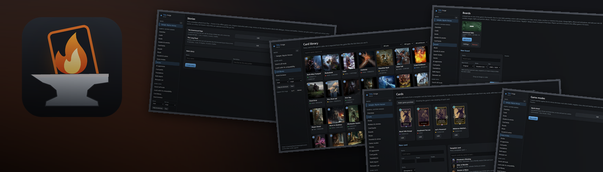
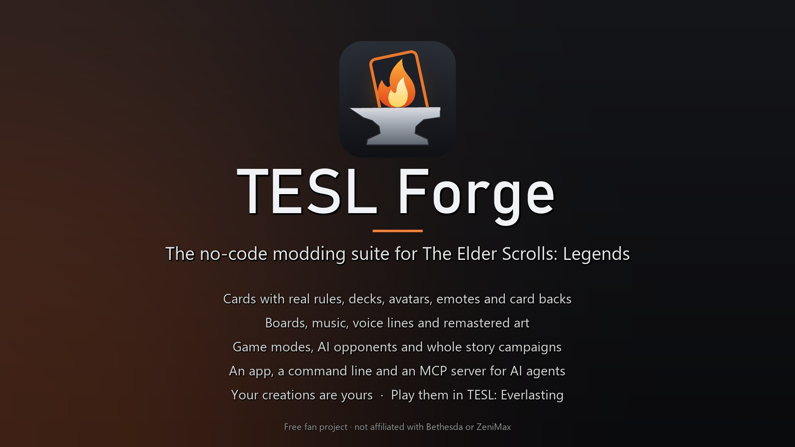
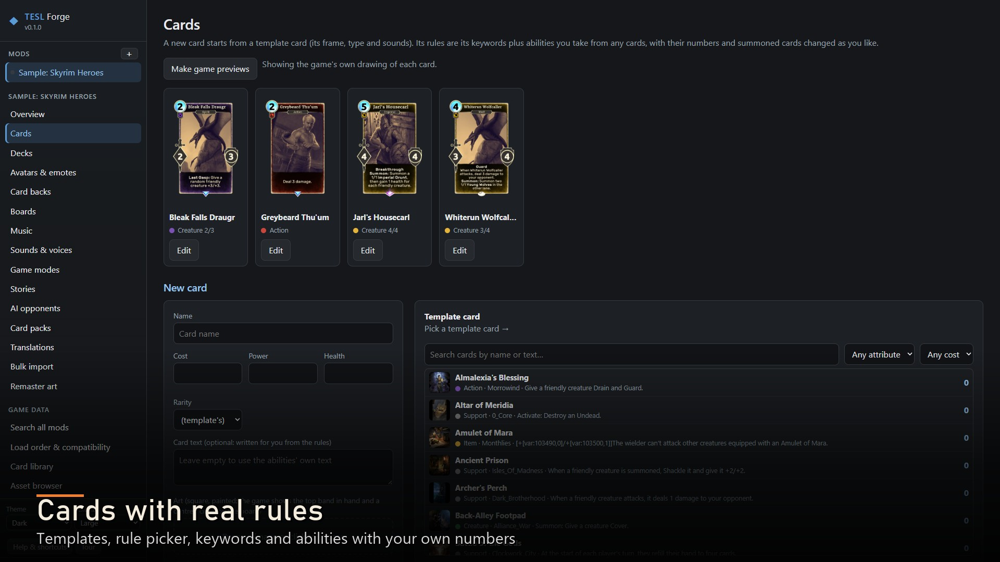
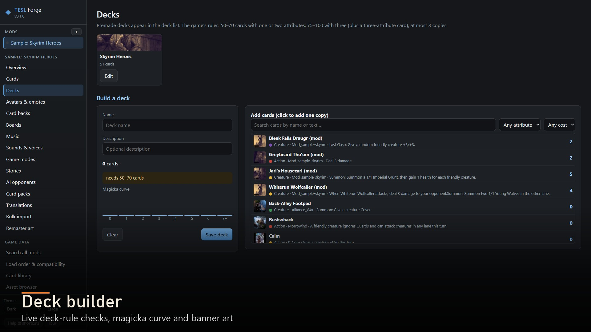
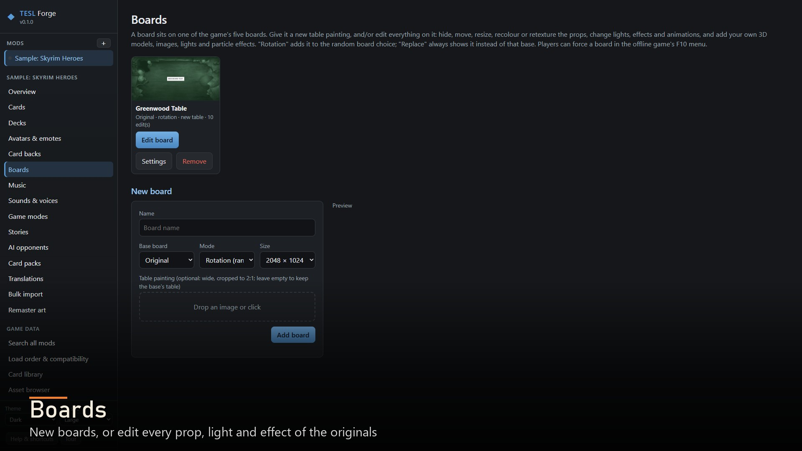
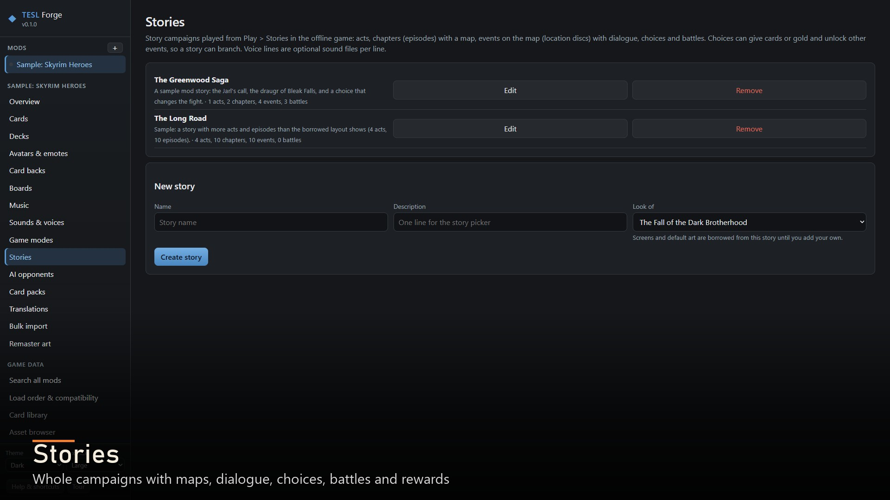
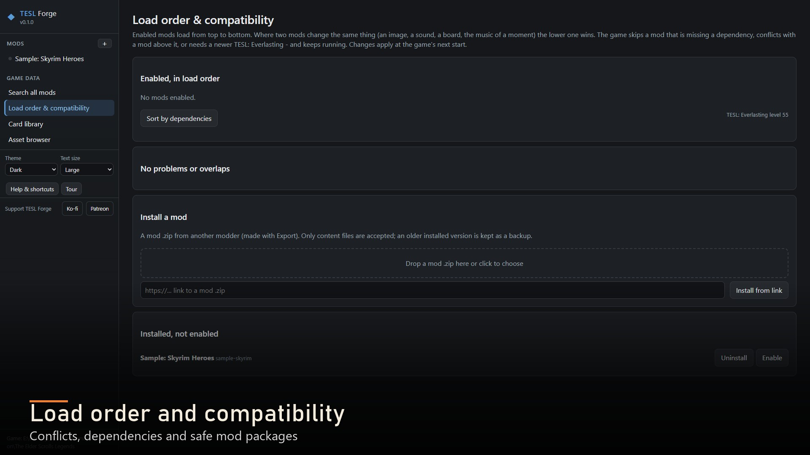
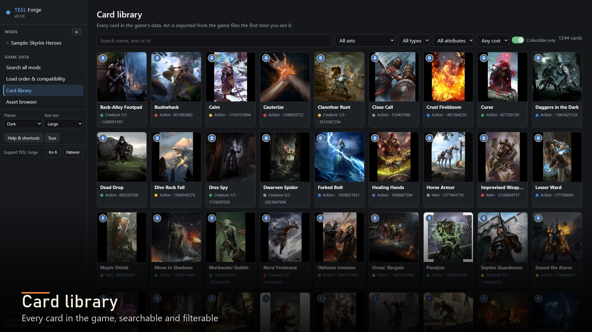
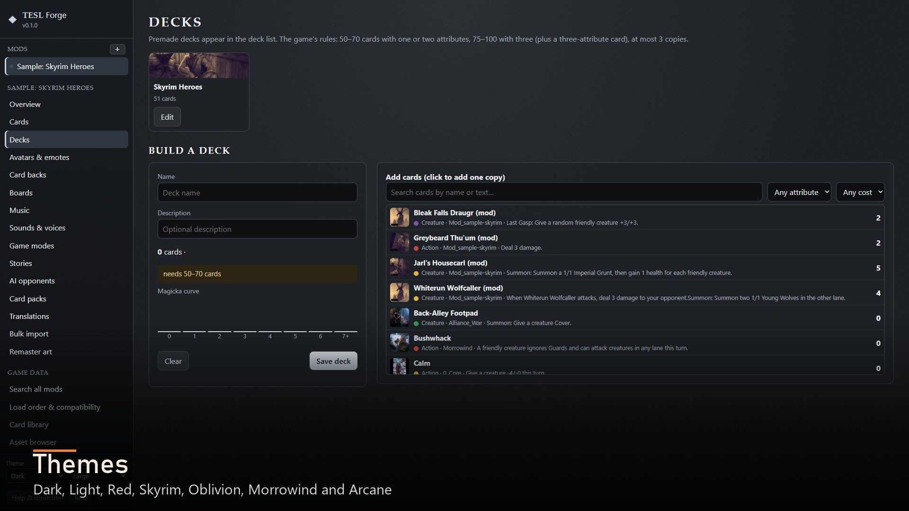

# TESL Forge

**The no-code modding suite and mod manager for *The Elder Scrolls: Legends*.** Make new cards with real rules, decks,
avatars and emotes, card backs, boards, music, voice lines, remastered art, AI opponents, card packs, game modes and
whole story campaigns without writing a line of code. Install, switch on and check mods in one place, then play them in
[TESL: Everlasting](https://github.com/ArchAngelAries/tesl-everlasting).

Everything the app does is also a command and an MCP tool, so AI assistants such as Claude Code or Codex can build mods
with you.

## Not affiliated

TESL: Everlasting, TESL Forge and our content mods are free fan projects. They are not affiliated with, endorsed by or
supported by Bethesda Softworks, ZeniMax Media, Microsoft, Dire Wolf Digital or Sparkypants, the makers of *The Elder
Scrolls: Legends*. *The Elder Scrolls*, *The Elder Scrolls: Legends* and all related names, characters and lore belong
to their owners.

## Features

- **Cards with real rules:** start from any card, take abilities from any game card and change their numbers, add
  keywords, set cost, power and health. Card art is framed to the game's card window so faces and heads stay in
  view, and the game itself draws previews.
- **Decks** with the game's deck rules checked as you build, a magicka curve and banner art.
- **Avatars and emotes:** new avatar choices with their own portraits, emote text and voice lines, and extra emotes.
- **AI opponents:** characters with a portrait, deck, difficulty and personality.
- **Card backs and card packs** sold for gold in the offline store, packs with their own drop tables.
- **Boards:** new table art, or edit any original board's props, lights, effects and animations; add your own 3D models.
- **Music, sounds and voices:** soundtracks for any moment, replacement of any game sound, voice lines for your cards.
- **Remaster art:** replace card art and other game images at any resolution.
- **Game modes:** your own lanes, health, magicka, runes, decks, starting cards, turn rules, board, music and rewards.
- **Stories:** campaigns with acts, episodes, maps, dialogue with choices and voices, battles, branching and rewards,
  reusing the game's own story art if you like.
- **Translations and bulk import:** every text per language; many cards, pictures or tracks at once.
- **Mod manager:** install mod packages, load order, dependency and conflict checks, Play test, search across mods,
  details, releases with a changelog, and packages ready to share.
- **Library and asset browser:** every card and all ~70,000 game assets, labelled and exportable.
- **Safe by design:** never changes game files; undo and history, autosaved drafts, problems linked to the item.
- **Its own window** with themes (Dark, Light, Red, Skyrim, Oblivion, Morrowind, Arcane), a help tour and keyboard
  shortcuts.

<!-- screenshots:start -->
## Screenshots

| | |
|---|---|
|  TESL Forge |  Cards, drawn by the game itself |
|  Decks |  Boards |
|  Stories |  Load order and compatibility |
|  The card library |  Themes |

More in [docs/screenshots](docs/screenshots).
<!-- screenshots:end -->

## Requirements

- Windows 10 or 11.
- *The Elder Scrolls: Legends* for PC, installed.
- [TESL: Everlasting](https://github.com/ArchAngelAries/tesl-everlasting) 1.0, to play your mods.
- The installer needs nothing else. The zip version needs [Python 3.10 or newer](https://www.python.org/downloads/).
- Optional: [ffmpeg](https://ffmpeg.org/) for converting audio files and [Blender](https://www.blender.org/) for importing
  FBX and .blend models. Listening to the game's own sounds uses FMOD, which TESL Forge downloads once when you ask
  (Sounds page, "Get game-audio support").

## Installation

**Installer (recommended)**
1. Run **TESL-Forge-Setup-1.0.0.exe**. It installs for your Windows user only, with no administrator prompt.
2. Open **TESL Forge** from the Start menu. It finds the game, or asks you to pick the game folder once.
3. Your mods live in `Documents\TESL Forge` and survive updates and uninstalling.

**Zip version (with the `tesl` command line)**
1. Unzip **TESL-Forge-1.0.0.zip** anywhere outside the game folder.
2. Double-click **Set up TESL Forge.cmd** once (it prepares TESL Forge's own Python environment), then
   **Open TESL Forge.cmd**.

**Installing a mod:** **Load order & compatibility** > **Install a mod**, choose the mod's zip, switch it on, then start the
game. TESL Forge is the mod manager for TESL mods; Vortex and Mod Organizer don't handle them.

## Fair play

Cheats, gameplay mods and AI-controlled players are for offline play against the in-game AI only. Online, TESL:
Everlasting loads only local visual and audio mods and graphics options. If a game running TESL: Everlasting's offline
code tries to join a remote match, it is closed immediately. No cheating against other players, by people or by AI.

## Works alongside TESL Reborn

TESL Reborn is a separate community project that brings back online play. Our tools work alongside it in the same game
folder: with it installed, the F10 menu switches between offline play and online play, and online launches use only
local visual and audio mods. We are not part of TESL Reborn and it has its own team, support and rules. **Please don't
contact the TESL Reborn team about our mods or tools**; report problems on our pages instead.

## Your creations are yours

TESL Forge is free and may never be sold. What you make with it belongs to you, including if you want to sell it.
Material that belongs to Bethesda (original art, audio, text) stays theirs, so mods made from your own work are the ones
you can safely share and sell.

## Your copy of the game

You need *The Elder Scrolls: Legends* for PC installed. None of our downloads contain the game. We don't ask how anyone
came by their copy and we treat every player the same: we don't condone unofficial copies, and we don't condemn anyone
for playing an unofficial copy of a free-to-play game that its makers no longer offer or support.

## Independently developed

All code, tools and new assets were developed independently for these projects. Neither download includes the game.

## Made with AI tools

TESL: Everlasting and TESL Forge were built with **Claude Code** (Anthropic), which made these projects possible, together
with **ArchAngelAries**, who designed, directed and tested them. OpenAI's Codex helped with parts of the early engine work.
Program code, rules work and documentation were written this way; screenshots come from the game and the app themselves.

## Releases and development builds

Nexus Mods is the official home of releases. Development happens on GitHub, where the newest changes land first and every
release is published too: [TESL: Everlasting](https://github.com/ArchAngelAries/tesl-everlasting) ·
[TESL Forge](https://github.com/ArchAngelAries/tesl-forge).

## Shout-outs

- **K0lb3** for UnityPy and its companion libraries, which make reading Unity games possible.
- **crow2cr0w** ([tesl-offline](https://github.com/crow2cr0w/tesl-offline)) for the original card rule data.
- **The UESP editors** for years of Legends documentation.
- **The TESL Reborn team** for keeping online play alive.
- **Dire Wolf Digital, Sparkypants and Bethesda** for the game itself.
- FMOD Studio by Firelight Technologies Pty Ltd, used to decode game audio when installed.

## License

Free for noncommercial use: PolyForm Noncommercial 1.0.0 with additional permissions (see `LICENSE`). Third-party parts:
`NOTICE.md`.

## Support

Everything here is free and stays free. If you'd like to help:

- Ko-fi: https://ko-fi.com/archangelaries
- Patreon: https://www.patreon.com/c/ArchAngelAries

Report problems on the mod's Nexus page or on the GitHub issue trackers of
[TESL: Everlasting](https://github.com/ArchAngelAries/tesl-everlasting/issues) and
[TESL Forge](https://github.com/ArchAngelAries/tesl-forge/issues).
